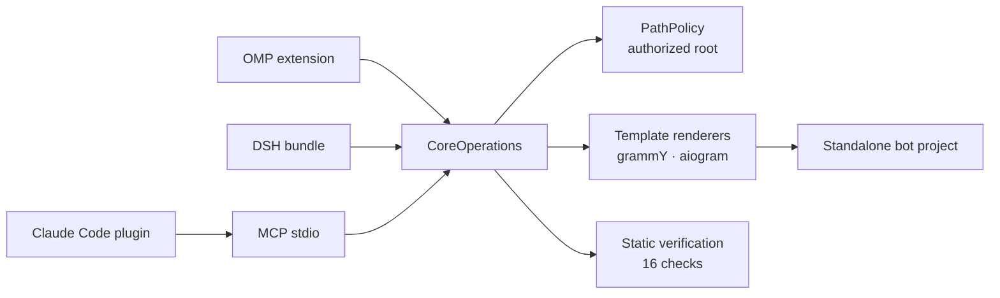

<p align="center">
  
</p>

<h1 align="center">Aurifex</h1>

<p align="center"><strong>Production Telegram bots from one agent request — scaffolded, secured, tested, and ready to deploy.</strong></p>

<p align="center">
  
  
  
  
  
</p>

```sh
git clone https://github.com/lukavtz/aurifex
cd aurifex && pnpm install && pnpm build
node dist/cli.js install --host all
```

<p align="center">
  
</p>

Aurifex gives a coding agent a production path for Telegram bots. It runs in OMP,
DeepSeek Harness, Claude Code, and any MCP client. TypeScript + grammY and Python +
aiogram are first-class. One domain core owns scaffolding, security policy, verification,
and deploy plans; thin host adapters project the same eight tools into each agent.

## What it does

Give the agent a bot spec. Aurifex writes a standalone project with a typed Bot API 10.4
layer, webhook hardening, update deduplication, retries, storage, Docker, and offline
tests. The verification gate checks the result before anything ships.

```console
$ node dist/cli.js target --stack grammy
grammy 1.46.0 (Bot API 10.4)

$ node dist/cli.js verify my-bot
ok: 16 pass, 1 warn, 0 fail
```

In a fresh scaffold the warning is `deps.lockfile`: install dependencies once and commit
the lockfile.

## Why it is different

- **One core, not four implementations.** The OMP extension, DSH bundle, and MCP server
  only translate schemas. Every filesystem write goes through the same `CoreOperations`
  and `PathPolicy`, which bounds it to an authorized root.
- **Generated bots are standalone.** A scaffolded project does not import `aurifex`. It
  owns its source, lockfile, Dockerfile, Caddyfile, and webhook registration script.
- **Bot API 10.4 is explicit, not implied.** grammY 1.46 and aiogram 3.31 type declarations
  stop at 10.3. Every project includes a typed raw adapter for `sendWidget`,
  `sendSharedWidget`, `answerWidgetQuery`, `editMessageWidgetData`,
  `editSharedWidgetData`, `sendRichMessage`, and `sendRichMessageDraft`; ephemeral
  replies use `sendMessage` with `ephemeral_message_parameters`.
- **Verification is a gate.** A token literal, missing webhook secret, root container,
  absent `update_id` deduplication, missing `retry_after` handling, or removed 10.4
  adapter makes `verify` fail.

## How it works



Each host exposes the same tools: `telegram_bot_target_resolve`,
`telegram_bot_scaffold`, `telegram_bot_inspect`, `telegram_bot_verify`,
`telegram_bot_add_feature`, `telegram_bot_deploy_plan`, `telegram_bot_test_harness`, and
`telegram_bot_upgrade_plan`. The package also ships skills for the Bot API (including
10.4), grammY, aiogram, security, testing, deploy, payments, and Mini Apps, plus
architecture, security-review, and test-writing subagents.

## Install

v0.1 is distributed from the repository; the npm package is not published yet.

```sh
git clone https://github.com/lukavtz/aurifex
cd aurifex && pnpm install && pnpm build
node dist/cli.js install --host all
```

After the build, one installer command covers every host. It detects OMP, DSH, and Claude
Code, prints every command it will run, and skips hosts that are not on `PATH`. `--dry-run` previews without executing; `--json`
returns a `DomainResult`. `--scope user|project` applies to OMP and Claude Code; `--profile <name>` applies
to DSH.

```sh
node dist/cli.js install --host all --dry-run
```

`omp plugin link .` and `claude plugin marketplace add` need a complete `dist`; run
`pnpm build` first. If `dist/cli.js` exists but `dist/adapters/mcp/server.js` does not,
`node dist/cli.js install` runs the build before installing.

Manual equivalents:

```sh
# OMP, from the checkout
omp plugin link .

# DeepSeek Harness
dsh plugin --profile aurifex add /absolute/path/to/aurifex

# Claude Code, from the checkout
claude plugin marketplace add /absolute/path/to/aurifex
claude plugin install aurifex@aurifex
```

After npm publish, the same flow becomes `npx -y aurifex install --host all`, and
per-host commands accept the package name instead of a checkout path.

Examples run the CLI as `node dist/cli.js` from the checkout. If `aurifex` is on `PATH`
(or after npm publish), use `aurifex` instead.

### MCP

From a built checkout, point the client at the built server:

```json
{
  "mcpServers": {
    "aurifex": {
      "command": "node",
      "args": ["/absolute/path/to/aurifex/dist/adapters/mcp/server.js"],
      "env": { "AURIFEX_ROOT": "/absolute/path/to/workspace" }
    }
  }
}
```

The Claude Code plugin already points at
`${CLAUDE_PLUGIN_ROOT}/dist/adapters/mcp/server.js` through `.mcp.json`.

After npm publish, the package also exposes the `aurifex-mcp` bin:

```json
{
  "mcpServers": {
    "aurifex": {
      "command": "npx",
      "args": ["-y", "-p", "aurifex", "aurifex-mcp"]
    }
  }
}
```

`AURIFEX_ROOT` bounds every read and write; it defaults to the process working directory.

## Quick start

Save a spec:

```json
{
  "schemaVersion": "bot-spec-1.0.0",
  "name": "my_bot",
  "displayName": "My Bot",
  "stack": "grammy",
  "features": ["commands"],
  "deployment": "docker",
  "storage": { "postgres": false, "redis": false },
  "i18n": { "defaultLocale": "en", "en": true, "ru": false },
  "security": {
    "webhookSecret": true,
    "adminAllowlist": true,
    "rateLimit": true,
    "idempotency": true
  }
}
```

Scaffold, run the generated tests, add a feature, and plan the deploy:

```sh
node dist/cli.js new my-bot --spec bot.json
cd my-bot
cp .env.example .env        # set BOT_TOKEN and WEBHOOK_SECRET
bun install
bun run typecheck && bun test

cd ..
node dist/cli.js add my-bot --feature payments --name stars
node dist/cli.js verify my-bot
node dist/cli.js deploy my-bot --domain bot.example.com
```

For `"stack": "aiogram"`, replace the Bun steps with `uv sync && uv run pytest`. The
generated `README.md` contains the exact commands and environment variables for that
project.

`deploy` writes the deploy files and a `setWebhook` script with `allowed_updates`,
`secret_token`, and `max_connections`. It never calls Telegram. Registering the webhook
stays an explicit operator action.

## What gets generated

```text
my-bot/
├── .env.example  .gitignore  .dockerignore
├── Dockerfile  docker-compose.yml  Caddyfile
├── package.json  tsconfig*.json          # or pyproject.toml + alembic.ini
├── src/                                  # app/ for aiogram
│   ├── config.ts  logger.ts  bot.ts  main.ts  server.ts
│   ├── telegram/api104.ts                # app/services/api104.py
│   ├── features/                         # start, help, admin, widgets, rich, ...
│   ├── security/                         # allowlist, dedupe, rate-limit, retry
│   └── storage/                          # database and schema
├── miniapp/                              # React + Vite, when enabled
├── tests/                                # offline; no Telegram calls
└── .github/workflows/ci.yml
```

Every generated project keeps these invariants:

- `.env.example` contains empty placeholders; no real or token-shaped secret is written.
- Webhook mode requires `X-Telegram-Bot-Api-Secret-Token`, HTTPS, and an allowed port.
  The framework callback compares the secret; custom `==` comparisons fail verification.
- `allowed_updates` is explicit, `update_id` deduplication claims a 24-hour Redis key
  (`SET NX EX 86400`), and `retry_after` is handled. Without Redis, local mode logs a
  warning and does not deduplicate.
- Admin commands check `ADMIN_IDS` on the server, not in the client.
- Mini App `initData`, when the feature is enabled, is validated with HMAC-SHA256 and an
  `auth_date` freshness limit.
- The container runs as a non-root user.

## Verification gate

`verify` runs 16 deterministic checks over a bounded snapshot (64 MiB total, 1 MiB per
file). Any `fail` makes `ok: false`; warnings remain visible. The checks cover token
literals, `.env` handling, webhook secret and transport rules, constant-time comparison,
container user, update policy, deduplication, retries, tests, the 10.4 adapter, lockfile,
log redaction, and the admin allowlist.

```sh
node dist/cli.js verify my-bot           # human summary
node dist/cli.js verify my-bot --json    # DomainResult with evidence
```

## Commands

| Command                | What it does                                                           |
| ---------------------- | ---------------------------------------------------------------------- |
| `aurifex target`       | Resolve exact framework, runtime, Bot API, and feature support.        |
| `aurifex new`          | Scaffold a standalone project from a strict `BotSpec`.                 |
| `aurifex inspect`      | Read-only detection of stack, mode, and scanned files.                 |
| `aurifex verify`       | Run the static verification gate and return evidence.                  |
| `aurifex add`          | Add one feature module without rewriting unrelated files.              |
| `aurifex deploy`       | Write deploy files and a webhook registration script; no API call.     |
| `aurifex harness`      | Write update fixtures, a fake transport, and a tgfake compose profile. |
| `aurifex upgrade-plan` | List the Bot API 10.4 migration actions that apply to a project.       |
| `aurifex install`      | Install the package into OMP, DSH, and Claude Code in one pass.        |

All commands accept `--json` and emit a stable `DomainResult`. Exit codes are `0` for
success, `1` for a domain error, and `2` for invalid usage.

## Development

```sh
pnpm install
pnpm build
pnpm verify
```

`pnpm verify` runs formatting, lint, strict TypeScript, unit, security, integration, and
host contract suites, then the secret scan and package dry-run. Design details live in
[`docs/SPEC.md`](./docs/SPEC.md) and [`docs/ARCHITECTURE.md`](./docs/ARCHITECTURE.md).
Generated-project E2E skips unless `AURIFEX_E2E=1` and needs Bun and uv:

```sh
AURIFEX_E2E=1 pnpm test:e2e
```

Live Telegram checks are opt-in and fail loudly if enabled without secrets:

```sh
AURIFEX_LIVE=1 \
TELEGRAM_TEST_BOT_TOKEN=... \
TELEGRAM_TEST_CHAT_ID=... \
pnpm test:e2e:live
```

## Limits

- **10.4 through a raw adapter.** grammY 1.46.0 and aiogram 3.31.0 types cover Bot API
  10.3. Aurifex never claims native 10.4 types; the generated adapter is the supported
  path, and `botapi.104` fails if it is removed.
- **Verification is static.** `verify` does not execute project code, start containers,
  or call Telegram. Runtime proof comes from the generated tests and the gated E2E runs.
- **Docker is not in the default gate.** The tgfake compose profile and image builds are
  optional; `pnpm verify` stays offline and deterministic.
- **Live tests need real secrets.** Without `AURIFEX_LIVE=1` the live suite skips. With it
  set, missing `TELEGRAM_TEST_BOT_TOKEN` or `TELEGRAM_TEST_CHAT_ID` is a failure.
- **The plugin is not a sandbox.** It runs in the host process. Filesystem access is
  bounded by `PathPolicy`, but the host extension process itself is trusted code.
- **Bot API only.** v0.1 does not cover MTProto or userbot automation.

## License

MIT. Adapted skill material is attributed in
[THIRD_PARTY_NOTICES.md](./THIRD_PARTY_NOTICES.md).
