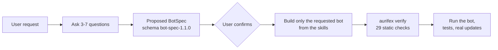

<p align="center">
  
</p>

<h1 align="center">Aurifex</h1>

<p align="center"><strong>Knowledge that builds a production Telegram bot.<br/>And a deterministic gate that proves the result.</strong></p>

<p align="center">
  
  
  
  
  
  
  
</p>

<p align="center">
  <a href="https://lukavtz.github.io/aurifex/"><strong>Website</strong></a>
  ·
  <a href="./docs/ARCHITECTURE.md">Architecture</a>
  ·
  <a href="./docs/CLI.md">CLI</a>
  ·
  <a href="./docs/TEST_PLAN.md">Test plan</a>
</p>

<p align="center">
  
</p>

Aurifex is a plugin for agent harnesses — OMP, DeepSeek Harness, and Claude Code — that
teaches a coding agent how to build an ideal Telegram bot for a specific request, where
to find current facts, and how to check the result. There is no project generator. The
agent has file tools, so it writes the bot itself from the knowledge; Aurifex supplies
the procedure, the references, and `aurifex verify` as a static gate.

TypeScript + grammY and Python + aiogram are first-class. Bot API 10.4 is the target.

## What it ships

| Surface                  | Contents                                                                                                                                                                                |
| ------------------------ | --------------------------------------------------------------------------------------------------------------------------------------------------------------------------------------- |
| **15 skills**            | A router (`telegram-bot`), discovery, sources, stack choice, recipes, failure catalogue, API limits, Bot API 10.4, grammY, aiogram, payments, Mini Apps, deployment, security, testing. |
| **3 MCP tools**          | `telegram_bot_target_resolve`, `telegram_bot_inspect`, `telegram_bot_verify`.                                                                                                           |
| **4 CLI commands**       | `target`, `inspect`, `verify`, `install`.                                                                                                                                               |
| **29 checks**            | Static file-content verification, grouped by the invariant it protects.                                                                                                                 |
| **2 reference projects** | Hand-written grammY and aiogram bots that pass their own tests and `aurifex verify`.                                                                                                    |

## Install

```sh
npx aurifex install
```

Or run the installer script, which keeps a persistent checkout at `~/.aurifex/src`
(`%LOCALAPPDATA%\Aurifex\src` on Windows), builds it once, and runs the CLI installer:

```sh
# macOS / Linux
curl -fsSL https://raw.githubusercontent.com/lukavtz/aurifex/main/install.sh | sh
```

```powershell
# Windows PowerShell
powershell -c "irm https://raw.githubusercontent.com/lukavtz/aurifex/main/install.ps1 | iex"
```

From a checkout, call the CLI directly:

```sh
node dist/cli.js install
```

The installer is interactive. It asks which hosts and which scope to install, then runs
the host integration commands and exits on its own. Non-interactive runs use
`AURIFEX_HOSTS=omp,claude`, `AURIFEX_SCOPE=user|project`, or `AURIFEX_YES=1`.
`AURIFEX_DRY_RUN=1` prints the host commands without running them.
`AURIFEX_REF` selects the repository ref (default `main`); `AURIFEX_SOURCE_DIR` selects a
local checkout. The CLI also accepts `install --source <path>`.

The installer creates an `aurifex` launcher in `~/.local/bin`
(`%LOCALAPPDATA%\Aurifex\bin` on Windows). If that directory is not on `PATH`, run the
CLI by path:

```sh
node "$HOME/.aurifex/src/dist/cli.js" --help
```

## What the agent does



1. **Ask first.** The agent reads `telegram-bot` and `telegram-bot-discovery`, asks 3–7
   questions in one block, and proposes a `BotSpec`. It never invents the stack,
   features, storage, locales, or payment products.
2. **Confirm.** No code is written before the user accepts the spec. Adding inline
   buttons when the user asked for inline buttons is the whole job; there is no feature
   catalogue to pad the request with.
3. **Build.** The agent writes the project in the confirmed stack, following
   `telegram-bot-recipes` for layout and flows and the framework skill for exact APIs.
4. **Verify.** `aurifex verify` reports `pass`, `warn`, and `fail` per check. Any `fail`
   makes the result `ok: false`.
5. **Prove behaviour.** Static checks do not run code. Behavioural evidence comes from
   the project's own tests and from real updates.

See [`docs/SPEC.md`](./docs/SPEC.md) for the contract and
[`docs/ARCHITECTURE.md`](./docs/ARCHITECTURE.md) for the module map.

## Tools

Every host projects the same three tools. Each returns a stable `DomainResult`.

| Tool                          | Input                               | Returns                                                                      |
| ----------------------------- | ----------------------------------- | ---------------------------------------------------------------------------- |
| `telegram_bot_target_resolve` | `{ stack }` — `grammy` or `aiogram` | Pinned framework and runtime versions, Bot API version, and warnings.        |
| `telegram_bot_inspect`        | `{ projectRoot }`                   | Detected stack, framework version, delivery mode, Bot API gap, and findings. |
| `telegram_bot_verify`         | `{ projectRoot }`                   | 29 static checks with `pass`/`warn`/`fail`, evidence paths, and a summary.   |

`inspect` and `verify` never execute project code, touch the network, or call Telegram.
The MCP server speaks protocol revision `2025-11-25` over stdio and has no runtime
dependencies.

## CLI

| Command                                  | Effect                                              |
| ---------------------------------------- | --------------------------------------------------- |
| `aurifex target --stack grammy\|aiogram` | Resolve the pinned framework, runtime, and Bot API. |
| `aurifex inspect <root>`                 | Read-only detection of stack, mode, and findings.   |
| `aurifex verify <root>`                  | Run the static gate; any `fail` makes `ok: false`.  |
| `aurifex install`                        | Install the plugin into OMP, DSH, and Claude Code.  |

Every command accepts `--json` and prints one `domain-result-1.0.0` object. Exit codes:
`0` success, `1` domain error, `2` invalid usage. Full flag list:
[`docs/CLI.md`](./docs/CLI.md).

```console
$ aurifex target --stack grammy
grammy 1.46.0 (Bot API 10.4)
```

## Where current facts come from

The skills do not rely on model memory for API facts. They define a procedure:

- `python3 skills/telegram-bot-sources/scripts/tg_docs.py method NAME`, `type NAME`,
  `page KEY`, and
  `changelog --entries N` read the official Bot API pages from a local cache.
  Exit code `0` means found, `1` means no such page, `2` is an argument error, and `3`
  means no network — the fact is then reported as unverified, not guessed.
- Context7 resolves the installed library and queries documentation for the exact
  version (`/aiogram/aiogram` for aiogram).
- Release pages pin the SDK version actually in use:
  [grammY releases](https://github.com/grammyjs/grammY/releases) and
  [aiogram releases](https://github.com/aiogram/aiogram/releases).
- A missing documentation page is not proof that a method does not exist. The local SDK
  installed in the project outranks the model's memory.

The procedure lives in the `telegram-bot-sources` skill; the URLs and page keys live in
its references.

## Verification

`verify` reads a bounded snapshot (64 MiB total, 1 MiB per file) and matches textual
markers. It does not execute project code, start containers, or call Telegram. A marker
can be present while the behaviour is wrong, so a passing gate is necessary, not
sufficient.

| Group              | Check ids                                                                                             |
| ------------------ | ----------------------------------------------------------------------------------------------------- |
| Secrets and config | `token.literal`, `scan.bounded`, `env.ignored`, `secrets.file`, `logs.redaction`, `allowlist.present` |
| Webhook            | `webhook.secret`, `webhook.https`, `webhook.port`, `webhook.constant_time`                            |
| Updates            | `updates.allowed`, `updates.dedupe`, `dedupe.fail_closed`, `retry.retry_after`                        |
| Containers         | `container.non_root`, `docker.healthcheck`                                                            |
| Bot API 10.4       | `botapi.104`, `botapi.104.types`                                                                      |
| Dependencies       | `deps.lockfile`                                                                                       |
| Queue              | `queue.worker`, `queue.schema`                                                                        |
| Payments           | `payments.schema`, `payments.validation`                                                              |
| Telemetry          | `telemetry.readiness`, `telemetry.metrics`                                                            |
| Mini App           | `miniapp.session`, `miniapp.csp`                                                                      |
| Tests              | `tests.present`, `tests.infrastructure`                                                               |

## Reference projects

`examples/grammy_commands` and `examples/aiogram_commands` are written by hand. They are
the proof that the knowledge produces working code, and the fixtures for `verify`.

- grammY `1.46.0`, Node `>=24.9.0`, `bun.lock`.
- aiogram `3.31.0`, Python 3.11–3.14, `uv.lock`.
- `/start` with an inline button, an acknowledged callback, one state file or table,
  configuration from environment variables, offline tests, `Dockerfile`, and compose.
- No `.aurifex/` directory and no manifest: nothing there was generated.

```sh
(cd examples/grammy_commands && bun install --frozen-lockfile && bun run typecheck && bun test)
(cd examples/aiogram_commands && uv sync --frozen && uv run pytest -q)
node dist/cli.js verify examples/grammy_commands --json
```

## Development

```sh
pnpm install
pnpm build
pnpm verify
```

`pnpm verify` runs formatting, lint, strict TypeScript, unit, security, fuzz,
integration, host, skill, site, secret, and package checks. The suite matrix is in
[`docs/TEST_PLAN.md`](./docs/TEST_PLAN.md). Release steps are in
[`docs/RELEASE.md`](./docs/RELEASE.md).

<details>
<summary>Manual host setup and MCP config</summary>

```sh
# OMP, from the built checkout
omp plugin link .

# DeepSeek Harness; the profile name is free, `aurifex` is the CLI default
dsh plugin --profile botdev add /absolute/path/to/aurifex

# Claude Code
claude plugin marketplace add /absolute/path/to/aurifex
claude plugin install aurifex@aurifex
```

```json
{
  "mcpServers": {
    "aurifex": {
      "command": "node",
      "args": ["/absolute/path/to/aurifex/dist/adapters/mcp/server.js"],
      "env": { "AURIFEX_ROOT": "/absolute/path/to/workspace" }
    }
  }
}
```

The Claude Code plugin already points at
`${CLAUDE_PLUGIN_ROOT}/dist/adapters/mcp/server.js` through `.mcp.json`. The server
speaks MCP over stdio without `node_modules`, so an installed plugin cache copy runs
as-is. `AURIFEX_ROOT` bounds every read; it defaults to the process working directory.

</details>

## Limits

- **Knowledge, not generation.** The plugin contains no project templates. Quality
  depends on the agent reading the skills and on the user confirming a spec; Aurifex
  does not build the bot for the agent.
- **Static verification.** `verify` matches file content. It does not execute the
  project, start containers, or call Telegram, and it cannot prove runtime behaviour.
- **10.4 goes through a raw adapter.** grammY 1.46.0 and aiogram 3.31.0 type Bot API
  10.3. Projects call 10.4-only methods through a typed raw adapter; Aurifex never
  claims native 10.4 framework types.
- **No network in the gate.** `pnpm verify` and `check-skills` run offline. Live
  documentation lookups are separate commands that need network.
- **Not a sandbox.** The plugin runs in the host process. Path access is bounded, but the
  host extension process is trusted code.
- **Bot API only.** MTProto and userbot automation are out of scope.

## License

MIT. Adapted skill material and bundled scripts are attributed in
[THIRD_PARTY_NOTICES.md](./THIRD_PARTY_NOTICES.md).
