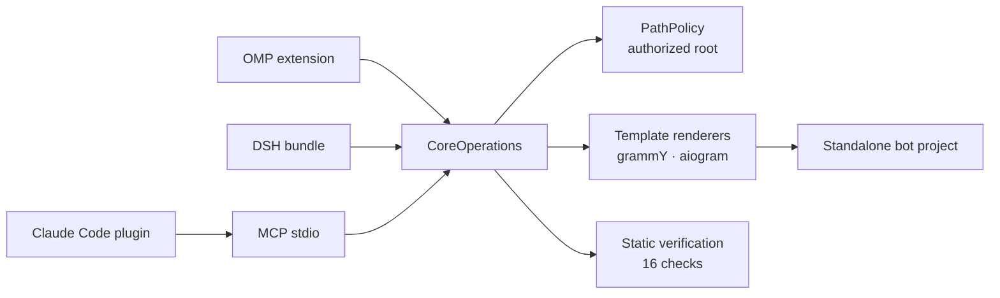

<p align="center">
  
</p>

<h1 align="center">Aurifex</h1>

<p align="center"><strong>Production Telegram bots from one agent request.<br/>Scaffolded, secured, tested, and ready to deploy.</strong></p>

<p align="center">
  
  
  
  
  
</p>

<p align="center">
  <a href="https://lukavtz.github.io/aurifex/"><strong>Website</strong></a>
  ·
  <a href="./docs/SPEC.md">Spec</a>
  ·
  <a href="./docs/ARCHITECTURE.md">Architecture</a>
  ·
  <a href="./docs/TEST_PLAN.md">Test plan</a>
</p>

<p align="center">
  
</p>

Aurifex gives a coding agent a production path for Telegram bots. It runs in OMP,
DeepSeek Harness, Claude Code, and any MCP client. TypeScript + grammY and Python +
aiogram are first-class. One domain core owns scaffolding, security policy, verification,
and deploy plans; thin host adapters project the same eight tools into each agent.

## One command

```sh
# macOS / Linux
curl -fsSL https://raw.githubusercontent.com/lukavtz/aurifex/main/install.sh | sh
```

```powershell
# Windows PowerShell
powershell -c "irm https://raw.githubusercontent.com/lukavtz/aurifex/main/install.ps1 | iex"
```

The script keeps a persistent checkout at `~/.aurifex/src`
(`%LOCALAPPDATA%\Aurifex\src` on Windows), builds it once, and runs
`aurifex install --host all`. Re-running updates that checkout.
`AURIFEX_DRY_RUN=1` prints the host commands without executing them.

## What it does

|              |                                                                                                                                         |
| ------------ | --------------------------------------------------------------------------------------------------------------------------------------- |
| **Scaffold** | Writes a standalone project from a strict `BotSpec`: webhook or polling, Docker, Caddy, Redis/Postgres, tests, and CI.                  |
| **Add**      | Nine features: commands, LLM chat, inline mode, Stars payments, Mini Apps, moderation, broadcasts, Bot API 10.4 widgets, rich messages. |
| **Verify**   | 16 deterministic checks over a bounded snapshot. A token literal or missing webhook secret is a failure, not a warning.                 |
| **Deploy**   | Render compose, Dockerfile, Caddyfile, and a `setWebhook` script. Never calls Telegram.                                                 |

```console
$ aurifex target --stack grammy
grammy 1.46.0 (Bot API 10.4)

$ aurifex verify my-bot
ok: 15 pass, 1 warn, 0 fail
```

The single warning on a fresh scaffold is `deps.lockfile`: install once and commit the
lockfile.

## Why it is different

- **One core, not four implementations.** OMP, DSH, Claude Code, and MCP translate
  schemas. Every write goes through the same `CoreOperations` and `PathPolicy`.
- **Generated bots are standalone.** A scaffold does not import `aurifex`. It owns its
  source, lockfile, Dockerfile, Caddyfile, and webhook registration script.
- **Bot API 10.4 is explicit.** Framework types stop at 10.3; every project ships a typed
  raw adapter for widgets, widget queries, ephemeral replies, and rich messages.
- **Verification is a gate.** A token literal, root container, missing `update_id`
  deduplication, missing `retry_after`, or removed 10.4 adapter makes `verify` fail.

## How it works



Each host exposes the same tools: `telegram_bot_target_resolve`,
`telegram_bot_scaffold`, `telegram_bot_inspect`, `telegram_bot_verify`,
`telegram_bot_add_feature`, `telegram_bot_deploy_plan`, `telegram_bot_test_harness`, and
`telegram_bot_upgrade_plan`.

## Quick start

```json
{
  "schemaVersion": "bot-spec-1.0.0",
  "name": "my_bot",
  "displayName": "My Bot",
  "stack": "grammy",
  "features": ["commands"],
  "deployment": "docker",
  "storage": { "postgres": false, "redis": false },
  "i18n": { "defaultLocale": "en", "en": true, "ru": false },
  "security": {
    "webhookSecret": true,
    "adminAllowlist": true,
    "rateLimit": true,
    "idempotency": true
  }
}
```

```sh
aurifex new my-bot --spec bot.json
cd my-bot
cp .env.example .env        # set BOT_TOKEN and WEBHOOK_SECRET
bun install
bun run typecheck && bun test

cd ..
aurifex add my-bot --feature payments --name stars
aurifex verify my-bot
aurifex deploy my-bot --domain bot.example.com
```

For `"stack": "aiogram"`, replace the Bun steps with `uv sync && uv run pytest`. The
generated `README.md` contains the exact commands and environment variables.

## What gets generated

```text
my-bot/
├── .env.example  .gitignore  .dockerignore
├── Dockerfile  docker-compose.yml  Caddyfile
├── package.json  tsconfig*.json          # or pyproject.toml + alembic.ini
├── src/                                  # app/ for aiogram
│   ├── config.ts  logger.ts  bot.ts  main.ts  server.ts
│   ├── telegram/api104.ts                # app/services/api104.py
│   ├── features/                         # start, help, admin, widgets, rich, ...
│   ├── security/                         # allowlist, dedupe, rate-limit, retry
│   └── storage/                          # database and schema
├── miniapp/                              # React + Vite, when enabled
├── tests/                                # offline; no Telegram calls
└── .github/workflows/ci.yml
```

### Security invariants

| Invariant            | Enforcement                                                                            |
| -------------------- | -------------------------------------------------------------------------------------- |
| No token in source   | Generated `.env.example` is empty; `token.literal` fails the gate.                     |
| Webhook authenticity | `X-Telegram-Bot-Api-Secret-Token`, HTTPS, allowed port, constant-time framework check. |
| Admin authority      | Numeric `ADMIN_IDS` checked on the server.                                             |
| No duplicate updates | `update_id` claims a 24-hour Redis key (`SET NX EX 86400`).                            |
| Flood control        | `retry_after` handled; rate limits per chat.                                           |
| Mini App identity    | `initData` HMAC-SHA256 with `auth_date` freshness.                                     |
| Container safety     | Non-root user; Caddy terminates TLS; no published bot port.                            |
| Dependency hygiene   | Exact pins, lockfile warning, `pnpm audit --prod` in CI.                               |

## Verification gate

`verify` runs 16 deterministic checks over a bounded snapshot (64 MiB total, 1 MiB per
file). Any `fail` makes `ok: false`; warnings remain visible.

```sh
aurifex verify my-bot           # human summary
aurifex verify my-bot --json    # DomainResult with evidence
```

## CLI

| Command                | What it does                                                 |
| ---------------------- | ------------------------------------------------------------ |
| `aurifex target`       | Resolve framework, runtime, Bot API, and feature support.    |
| `aurifex new`          | Scaffold a standalone project from a strict `BotSpec`.       |
| `aurifex inspect`      | Read-only detection of stack, mode, and scanned files.       |
| `aurifex verify`       | Run the static verification gate and return evidence.        |
| `aurifex add`          | Add one feature module without rewriting unrelated files.    |
| `aurifex deploy`       | Write deploy files and a webhook script; no API call.        |
| `aurifex harness`      | Write update fixtures, a fake transport, and tgfake compose. |
| `aurifex upgrade-plan` | List the Bot API 10.4 migration actions for a project.       |
| `aurifex install`      | Install into OMP, DSH, and Claude Code in one pass.          |

All commands accept `--json` and emit a stable `DomainResult`. Exit codes: `0` success,
`1` domain error, `2` invalid usage.

## Development

```sh
pnpm install
pnpm build
pnpm verify
AURIFEX_E2E=1 pnpm test:e2e
```

`pnpm verify` runs formatting, lint, strict TypeScript, unit, security, integration, host
contract, site, and secret checks, then the package dry-run. Design details live in
[`docs/SPEC.md`](./docs/SPEC.md) and [`docs/ARCHITECTURE.md`](./docs/ARCHITECTURE.md).

<details>
<summary>Manual host setup and MCP config</summary>

```sh
# OMP, from the built checkout
omp plugin link .

# DeepSeek Harness
dsh plugin --profile aurifex add /absolute/path/to/aurifex

# Claude Code
claude plugin marketplace add /absolute/path/to/aurifex
claude plugin install aurifex@aurifex
```

```json
{
  "mcpServers": {
    "aurifex": {
      "command": "node",
      "args": ["/absolute/path/to/aurifex/dist/adapters/mcp/server.js"],
      "env": { "AURIFEX_ROOT": "/absolute/path/to/workspace" }
    }
  }
}
```

The Claude Code plugin already points at
`${CLAUDE_PLUGIN_ROOT}/dist/adapters/mcp/server.js` through `.mcp.json`.
`AURIFEX_ROOT` bounds every read and write; it defaults to the process working directory.

</details>

## Limits

- **10.4 through a raw adapter.** grammY 1.46.0 and aiogram 3.31.0 types cover Bot API
  10.3. Aurifex never claims native 10.4 types; `botapi.104` fails if the adapter is
  removed.
- **Verification is static.** `verify` does not execute project code, start containers,
  or call Telegram. Runtime proof comes from generated tests and gated E2E runs.
- **Docker is not in the default gate.** Image builds are optional; `pnpm verify` stays
  offline and deterministic.
- **Live tests need real secrets.** Without `AURIFEX_LIVE=1` the live suite skips. With it
  set, missing `TELEGRAM_TEST_BOT_TOKEN` or `TELEGRAM_TEST_CHAT_ID` is a failure.
- **The plugin is not a sandbox.** It runs in the host process. Filesystem access is
  bounded by `PathPolicy`, but the host extension process itself is trusted code.
- **Bot API only.** v0.1 does not cover MTProto or userbot automation.

## License

MIT. Adapted skill material is attributed in
[THIRD_PARTY_NOTICES.md](./THIRD_PARTY_NOTICES.md).
