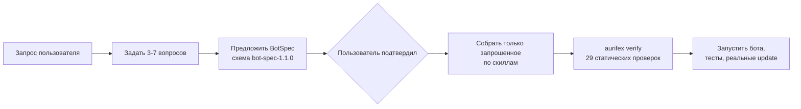

<p align="center">
  
</p>

<h1 align="center">Aurifex</h1>

<p align="center"><strong>Знание, которое собирает продакшен-бота Telegram.<br/>И детерминированный шлюз, который подтверждает результат.</strong></p>

<p align="center">
  
  
  
  
  
  
  
</p>

<p align="center">
  <a href="https://lukavtz.github.io/aurifex/"><strong>Сайт</strong></a>
  ·
  <a href="./docs/ARCHITECTURE.md">Архитектура</a>
  ·
  <a href="./docs/CLI.md">CLI</a>
  ·
  <a href="./docs/TEST_PLAN.md">План тестов</a>
</p>

<p align="center">
  
</p>

Aurifex — плагин для агентных харнессов OMP, DeepSeek Harness и Claude Code. Он учит
кодирующего агента, как собрать идеального бота Telegram под конкретный запрос, где
взять актуальные факты и как проверить результат. Генератора проектов больше нет:
у агента есть файловые инструменты, поэтому он пишет бота сам по знанию, а Aurifex
даёт процедуру, справочники и статический шлюз `aurifex verify`.

TypeScript + grammY и Python + aiogram поддерживаются полноценно. Целевая версия —
Bot API 10.4.

## Что внутри

| Поверхность             | Содержимое                                                                                                                                                                              |
| ----------------------- | --------------------------------------------------------------------------------------------------------------------------------------------------------------------------------------- |
| **15 скиллов**          | Роутер (`telegram-bot`), discovery, источники, выбор стека, рецепты, каталог ошибок, лимиты API, Bot API 10.4, grammY, aiogram, платежи, Mini Apps, деплой, безопасность, тестирование. |
| **3 MCP-инструмента**   | `telegram_bot_target_resolve`, `telegram_bot_inspect`, `telegram_bot_verify`.                                                                                                           |
| **4 команды CLI**       | `target`, `inspect`, `verify`, `install`.                                                                                                                                               |
| **29 проверок**         | Статическая проверка содержимого файлов, сгруппированная по инварианту.                                                                                                                 |
| **2 эталонных проекта** | Рукописные боты на grammY и aiogram; проходят свои тесты и `aurifex verify`.                                                                                                            |

## Установка

```sh
npx aurifex install
```

Или запустите скрипт установки: он держит постоянный checkout в `~/.aurifex/src`
(`%LOCALAPPDATA%\Aurifex\src` в Windows), один раз собирает его и запускает установщик
CLI:

```sh
# macOS / Linux
curl -fsSL https://raw.githubusercontent.com/lukavtz/aurifex/main/install.sh | sh
```

```powershell
# Windows PowerShell
powershell -c "irm https://raw.githubusercontent.com/lukavtz/aurifex/main/install.ps1 | iex"
```

Из checkout можно вызвать CLI напрямую:

```sh
node dist/cli.js install
```

Установщик интерактивен: он спрашивает хосты и область установки, выполняет команды
интеграции и завершается сам. Для запуска без диалога задайте
`AURIFEX_HOSTS=omp,claude`, `AURIFEX_SCOPE=user|project` или `AURIFEX_YES=1`.
`AURIFEX_DRY_RUN=1` печатает команды хостов без выполнения.
`AURIFEX_REF` выбирает ref репозитория (по умолчанию `main`), `AURIFEX_SOURCE_DIR` —
локальный checkout. CLI также принимает `install --source <path>`.

Установщик создаёт лаунчер `aurifex` в `~/.local/bin`
(`%LOCALAPPDATA%\Aurifex\bin` в Windows). Если каталог не входит в `PATH`, запускайте
CLI по пути:

```sh
node "$HOME/.aurifex/src/dist/cli.js" --help
```

## Что делает агент



1. **Сначала вопросы.** Агент читает `telegram-bot` и `telegram-bot-discovery`, задаёт
   3–7 вопросов одним блоком и предлагает `BotSpec`. Он не выдумывает стек, функции,
   хранилище, локали и платёжные продукты.
2. **Подтверждение.** Код не пишется до согласия пользователя. Просили инлайн-кнопки —
   делает инлайн-кнопки; каталога функций, которым можно дополнить запрос, нет.
3. **Сборка.** Агент пишет проект в подтверждённом стеке: раскладку и сценарии берёт из
   `telegram-bot-recipes`, точные API — из скилла фреймворка.
4. **Проверка.** `aurifex verify` возвращает `pass`, `warn` и `fail` по каждой проверке.
   Любой `fail` делает результат `ok: false`.
5. **Доказательство поведения.** Статические проверки не исполняют код. Поведение
   подтверждают тесты проекта и реальные update.

Контракт описан в [`docs/SPEC.md`](./docs/SPEC.md), карта модулей — в
[`docs/ARCHITECTURE.md`](./docs/ARCHITECTURE.md).

## Инструменты

Каждый хост проецирует одни и те же три инструмента. Каждый возвращает стабильный
`DomainResult`.

| Инструмент                    | Вход                                 | Результат                                                                                  |
| ----------------------------- | ------------------------------------ | ------------------------------------------------------------------------------------------ |
| `telegram_bot_target_resolve` | `{ stack }` — `grammy` или `aiogram` | Закреплённые версии фреймворка и runtime, версия Bot API, предупреждения.                  |
| `telegram_bot_inspect`        | `{ projectRoot }`                    | Определённый стек, версия фреймворка, режим доставки, разрыв Bot API, находки.             |
| `telegram_bot_verify`         | `{ projectRoot }`                    | 29 статических проверок со статусами `pass`/`warn`/`fail`, путями доказательств и сводкой. |

`inspect` и `verify` не исполняют код проекта, не обращаются к сети и не вызывают
Telegram. MCP-сервер говорит по stdio с ревизией протокола `2025-11-25` и не имеет
runtime-зависимостей.

## CLI

| Команда                                  | Действие                                                   |
| ---------------------------------------- | ---------------------------------------------------------- |
| `aurifex target --stack grammy\|aiogram` | Определяет закреплённые фреймворк, runtime и Bot API.      |
| `aurifex inspect <root>`                 | Только чтение: стек, режим и находки.                      |
| `aurifex verify <root>`                  | Запускает статический шлюз; любой `fail` даёт `ok: false`. |
| `aurifex install`                        | Устанавливает плагин в OMP, DSH и Claude Code.             |

Каждая команда принимает `--json` и печатает один объект `domain-result-1.0.0`.
Коды выхода: `0` — успех, `1` — доменная ошибка, `2` — неверное использование.
Полный список флагов — в [`docs/CLI.md`](./docs/CLI.md).

```console
$ aurifex target --stack grammy
grammy 1.46.0 (Bot API 10.4)
```

## Откуда берутся актуальные факты

Скиллы не полагаются на память модели для фактов API. Они задают процедуру:

- `python3 skills/telegram-bot-sources/scripts/tg_docs.py method NAME`, `type NAME`,
  `page KEY` и
  `changelog --entries N` читают официальные страницы Bot API из локального кэша.
  Код `0` — найдено, `1` — страницы нет, `2` — ошибка аргументов, `3` — нет сети;
  тогда факт помечается как непроверенный, а не выдумывается.
- Context7 определяет установленную библиотеку и запрашивает документацию по точной
  версии (`/aiogram/aiogram` для aiogram).
- Страницы релизов закрепляют версию SDK, которая реально используется:
  [релизы grammY](https://github.com/grammyjs/grammY/releases) и
  [релизы aiogram](https://github.com/aiogram/aiogram/releases).
- Отсутствие страницы документации не доказывает отсутствие метода. Установленный в
  проекте SDK важнее памяти модели.

Процедура живёт в скилле `telegram-bot-sources`, адреса и ключи страниц — в его
справочниках.

## Проверка

`verify` читает ограниченный снимок (64 МиБ всего, 1 МиБ на файл) и ищет текстовые
маркеры. Код проекта не исполняется, контейнеры не запускаются, Telegram не
вызывается. Маркер может присутствовать при неверном поведении, поэтому пройденный
шлюз необходим, но недостаточен.

| Группа                 | Id проверок                                                                                           |
| ---------------------- | ----------------------------------------------------------------------------------------------------- |
| Секреты и конфигурация | `token.literal`, `scan.bounded`, `env.ignored`, `secrets.file`, `logs.redaction`, `allowlist.present` |
| Webhook                | `webhook.secret`, `webhook.https`, `webhook.port`, `webhook.constant_time`                            |
| Обновления             | `updates.allowed`, `updates.dedupe`, `dedupe.fail_closed`, `retry.retry_after`                        |
| Контейнеры             | `container.non_root`, `docker.healthcheck`                                                            |
| Bot API 10.4           | `botapi.104`, `botapi.104.types`                                                                      |
| Зависимости            | `deps.lockfile`                                                                                       |
| Очередь                | `queue.worker`, `queue.schema`                                                                        |
| Платежи                | `payments.schema`, `payments.validation`                                                              |
| Телеметрия             | `telemetry.readiness`, `telemetry.metrics`                                                            |
| Mini App               | `miniapp.session`, `miniapp.csp`                                                                      |
| Тесты                  | `tests.present`, `tests.infrastructure`                                                               |

## Эталонные проекты

`examples/grammy_commands` и `examples/aiogram_commands` написаны вручную. Это
доказательство, что знание производит рабочий код, и фикстуры для `verify`.

- grammY `1.46.0`, Node `>=24.9.0`, `bun.lock`.
- aiogram `3.31.0`, Python 3.11–3.14, `uv.lock`.
- `/start` с инлайн-кнопкой, подтверждённый callback, один файл или таблица состояния,
  конфигурация из переменных окружения, офлайн-тесты, `Dockerfile` и compose.
- Каталога `.aurifex/` и manifest нет: ничего из этого не сгенерировано.

```sh
(cd examples/grammy_commands && bun install --frozen-lockfile && bun run typecheck && bun test)
(cd examples/aiogram_commands && uv sync --frozen && uv run pytest -q)
node dist/cli.js verify examples/grammy_commands --json
```

## Разработка

```sh
pnpm install
pnpm build
pnpm verify
```

`pnpm verify` запускает форматирование, линт, строгий TypeScript, unit-, security-,
fuzz-, integration-, host-, skill-, site-, secret- и package-проверки. Матрица наборов —
в [`docs/TEST_PLAN.md`](./docs/TEST_PLAN.md), шаги релиза — в
[`docs/RELEASE.md`](./docs/RELEASE.md).

<details>
<summary>Ручная установка хостов и MCP</summary>

```sh
# OMP, из собранного checkout
omp plugin link .

# DeepSeek Harness; имя профиля свободное, `aurifex` — значение по умолчанию в CLI
dsh plugin --profile botdev add /absolute/path/to/aurifex

# Claude Code
claude plugin marketplace add /absolute/path/to/aurifex
claude plugin install aurifex@aurifex
```

```json
{
  "mcpServers": {
    "aurifex": {
      "command": "node",
      "args": ["/absolute/path/to/aurifex/dist/adapters/mcp/server.js"],
      "env": { "AURIFEX_ROOT": "/absolute/path/to/workspace" }
    }
  }
}
```

Плагин Claude Code уже указывает на
`${CLAUDE_PLUGIN_ROOT}/dist/adapters/mcp/server.js` через `.mcp.json`. Сервер говорит
по MCP через stdio без `node_modules`, поэтому установленная копия плагина работает как
есть. `AURIFEX_ROOT` ограничивает чтение; по умолчанию — рабочий каталог процесса.

</details>

## Ограничения

- **Знание, а не генерация.** Шаблонов проектов в плагине нет. Качество зависит от
  того, прочитал ли агент скиллы и подтвердил ли пользователь спецификацию; Aurifex не
  собирает бота за агента.
- **Проверка статическая.** `verify` сопоставляет содержимое файлов. Он не исполняет
  проект, не запускает контейнеры и не вызывает Telegram, поэтому не доказывает
  поведение во время работы.
- **10.4 идёт через raw-адаптер.** Типы grammY 1.46.0 и aiogram 3.31.0 покрывают Bot
  API 10.3. Проекты вызывают методы 10.4 через типизированный raw-адаптер; Aurifex не
  заявляет нативные типы 10.4 во фреймворках.
- **В шлюзе нет сети.** `pnpm verify` и `check-skills` работают офлайн. Живой поиск
  документации — отдельные команды, которым нужна сеть.
- **Это не песочница.** Плагин работает в процессе хоста. Доступ к путям ограничен, но
  процесс расширения считается доверенным кодом.
- **Только Bot API.** MTProto и юзерботы вне области.

## Лицензия

MIT. Заимствованные материалы скиллов и встроенные скрипты атрибутированы в
[THIRD_PARTY_NOTICES.md](./THIRD_PARTY_NOTICES.md).
