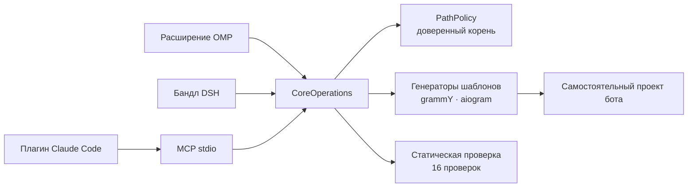

<p align="center">
  
</p>

<h1 align="center">Aurifex</h1>

<p align="center"><strong>Продакшен-боты Telegram по запросу агента: созданы, защищены, протестированы и готовы к деплою.</strong></p>

<p align="center">
  
  
  
  
  
</p>

```sh
git clone https://github.com/lukavtz/aurifex
cd aurifex && pnpm install && pnpm build
node dist/cli.js install --host all
```

<p align="center">
  
</p>

Aurifex даёт кодирующему агенту продакшен-путь для ботов Telegram. Он работает в OMP,
DeepSeek Harness, Claude Code и любом MCP-клиенте. TypeScript + grammY и Python +
aiogram поддерживаются полноценно. Одно доменное ядро отвечает за генерацию, политику
безопасности, проверку и план деплоя; тонкие адаптеры хостов проецируют одни и те же
восемь инструментов в каждого агента.

## Что делает

Дайте агенту спецификацию бота. Aurifex запишет самостоятельный проект с типизированным
слоем Bot API 10.4, защитой webhook, дедупликацией обновлений, повторами, хранилищем,
Docker и офлайн-тестами. Проверочный шлюз отбракует опасные изменения до публикации.

```console
$ node dist/cli.js target --stack grammy
grammy 1.46.0 (Bot API 10.4)

$ node dist/cli.js verify my-bot
ok: 15 pass, 1 warn, 0 fail
```

В свежем проекте предупреждение — `deps.lockfile`: установите зависимости один раз и
закоммитьте lock-файл.

## Чем отличается

- **Одно ядро, а не четыре реализации.** Расширение OMP, бандл DSH и MCP-сервер только
  переводят схемы. Каждая запись в файловую систему проходит через общие `CoreOperations`
  и `PathPolicy`, которые ограничивают её доверенным корнем.
- **Сгенерированные боты самостоятельны.** Проект не импортирует `aurifex`. У него есть
  собственный исходный код, lock-файл, Dockerfile, Caddyfile и скрипт регистрации webhook.
- **Bot API 10.4 указан явно, а не подразумевается.** Объявления типов grammY 1.46 и
  aiogram 3.31 заканчиваются на 10.3. Каждый проект получает типизированный raw-адаптер
  для `sendWidget`, `sendSharedWidget`, `answerWidgetQuery`, `editMessageWidgetData`,
  `editSharedWidgetData`, `sendRichMessage` и `sendRichMessageDraft`; эфемерные ответы
  используют `sendMessage` с `ephemeral_message_parameters`.
- **Проверка — это шлюз.** Токен-литерал, отсутствующий секрет webhook, контейнер под
  root, отсутствие дедупликации `update_id`, обработки `retry_after` или удалённый
  адаптер 10.4 приводят к `fail` в `verify`.

## Как работает



Каждый хост предоставляет одни и те же инструменты: `telegram_bot_target_resolve`,
`telegram_bot_scaffold`, `telegram_bot_inspect`, `telegram_bot_verify`,
`telegram_bot_add_feature`, `telegram_bot_deploy_plan`, `telegram_bot_test_harness` и
`telegram_bot_upgrade_plan`. Пакет также содержит skills по Bot API (включая 10.4),
grammY, aiogram, безопасности, тестированию, деплою, платежам и Mini Apps, а также
суб-агентов по архитектуре, security-ревью и написанию тестов.

## Установка

Одна команда устанавливает во все найденные хосты (OMP, DSH, Claude Code):

```sh
# macOS / Linux
curl -fsSL https://raw.githubusercontent.com/lukavtz/aurifex/main/install.sh | sh
```

```powershell
# Windows PowerShell
powershell -c "irm https://raw.githubusercontent.com/lukavtz/aurifex/main/install.ps1 | iex"
```

Скрипт хранит постоянный checkout в `~/.aurifex/src`
(`%LOCALAPPDATA%\Aurifex\src` в Windows), один раз собирает его и запускает
`aurifex install --host all`. Повторный запуск обновляет checkout.
`AURIFEX_DRY_RUN=1` печатает команды без выполнения.

Из checkout:
v0.1 распространяется из репозитория; npm-пакет ещё не опубликован.

```sh
git clone https://github.com/lukavtz/aurifex
cd aurifex && pnpm install && pnpm build
node dist/cli.js install --host all
```

После сборки одна команда установщика покрывает все хосты. Он находит OMP, DSH и
Claude Code, печатает каждую команду и пропускает хосты, которых нет в `PATH`. `--dry-run` показывает план без выполнения; `--json` возвращает
`DomainResult`. `--scope user|project` относится к OMP и Claude Code, `--profile <name>` — к DSH.

```sh
node dist/cli.js install --host all --dry-run
```

`omp plugin link .` и `claude plugin marketplace add` требуют полного `dist`; сначала
запустите `pnpm build`. Если `dist/cli.js` существует, а `dist/adapters/mcp/server.js`
нет, `node dist/cli.js install` выполнит сборку перед установкой.

Ручные эквиваленты:

```sh
# OMP, из checkout
omp plugin link .

# DeepSeek Harness
dsh plugin --profile aurifex add /absolute/path/to/aurifex

# Claude Code, из checkout
claude plugin marketplace add /absolute/path/to/aurifex
claude plugin install aurifex@aurifex
```

После публикации в npm тот же сценарий становится `npx -y aurifex install --host all`,
а команды хостов принимают имя пакета вместо пути к checkout.

Примеры запускают CLI как `node dist/cli.js` из checkout. Если `aurifex` есть в `PATH`
(или после публикации в npm), используйте `aurifex`.

### MCP

Из собранного checkout укажите клиенту собранный сервер:

```json
{
  "mcpServers": {
    "aurifex": {
      "command": "node",
      "args": ["/absolute/path/to/aurifex/dist/adapters/mcp/server.js"],
      "env": { "AURIFEX_ROOT": "/absolute/path/to/workspace" }
    }
  }
}
```

Плагин Claude Code уже указывает на
`${CLAUDE_PLUGIN_ROOT}/dist/adapters/mcp/server.js` через `.mcp.json`.

После публикации в npm пакет также предоставляет bin `aurifex-mcp`:

```json
{
  "mcpServers": {
    "aurifex": {
      "command": "npx",
      "args": ["-y", "-p", "aurifex", "aurifex-mcp"]
    }
  }
}
```

`AURIFEX_ROOT` ограничивает каждое чтение и запись; по умолчанию используется рабочий
каталог процесса.

## Быстрый старт

Сохраните спецификацию:

```json
{
  "schemaVersion": "bot-spec-1.0.0",
  "name": "my_bot",
  "displayName": "My Bot",
  "stack": "grammy",
  "features": ["commands"],
  "deployment": "docker",
  "storage": { "postgres": false, "redis": false },
  "i18n": { "defaultLocale": "en", "en": true, "ru": false },
  "security": {
    "webhookSecret": true,
    "adminAllowlist": true,
    "rateLimit": true,
    "idempotency": true
  }
}
```

Создайте проект, запустите сгенерированные тесты, добавьте функцию и спланируйте деплой:

```sh
node dist/cli.js new my-bot --spec bot.json
cd my-bot
cp .env.example .env        # укажите BOT_TOKEN и WEBHOOK_SECRET
bun install
bun run typecheck && bun test

cd ..
node dist/cli.js add my-bot --feature payments --name stars
node dist/cli.js verify my-bot
node dist/cli.js deploy my-bot --domain bot.example.com
```

Для `"stack": "aiogram"` замените шаги Bun на `uv sync && uv run pytest`. Точные команды
и переменные окружения для конкретного проекта есть в сгенерированном `README.md`.

`deploy` записывает файлы деплоя и скрипт `setWebhook` с `allowed_updates`,
`secret_token` и `max_connections`. Telegram он не вызывает. Регистрация webhook остаётся
явным действием оператора.

## Что генерируется

```text
my-bot/
├── .env.example  .gitignore  .dockerignore
├── Dockerfile  docker-compose.yml  Caddyfile
├── package.json  tsconfig*.json          # или pyproject.toml + alembic.ini
├── src/                                  # app/ для aiogram
│   ├── config.ts  logger.ts  bot.ts  main.ts  server.ts
│   ├── telegram/api104.ts                # app/services/api104.py
│   ├── features/                         # start, help, admin, widgets, rich, ...
│   ├── security/                         # allowlist, dedupe, rate-limit, retry
│   └── storage/                          # база данных и схема
├── miniapp/                              # React + Vite, если включено
├── tests/                                # офлайн; без вызовов Telegram
└── .github/workflows/ci.yml
```

Каждый сгенерированный проект соблюдает инварианты:

- В `.env.example` только пустые заглушки; реальный секрет или строка вида токена не
  записывается.
- Webhook требует `X-Telegram-Bot-Api-Secret-Token`, HTTPS и разрешённый порт. Секрет
  сравнивает callback фреймворка; собственные сравнения через `==` не проходят проверку.
- `allowed_updates` задан явно, дедупликация `update_id` занимает Redis-ключ на 24 часа
  (`SET NX EX 86400`), `retry_after` обрабатывается. Без Redis локальный режим пишет
  предупреждение и не дедуплицирует.
- Админ-команды проверяют `ADMIN_IDS` на сервере, а не на клиенте.
- `initData` Mini App, если функция включена, проверяется через HMAC-SHA256 с ограничением
  свежести `auth_date`.
- Контейнер работает не под root.

## Проверочный шлюз

`verify` выполняет 16 детерминированных проверок по ограниченному снимку (64 МиБ всего,
1 МиБ на файл). Любой `fail` делает `ok: false`; предупреждения остаются видимыми.
Проверки охватывают токен-литералы, обращение с `.env`, секрет и транспорт webhook,
сравнение за постоянное время, пользователя контейнера, политику обновлений,
дедупликацию, повторы, тесты, адаптер 10.4, lock-файл, редактирование логов и allowlist
администраторов.

```sh
node dist/cli.js verify my-bot           # краткий итог
node dist/cli.js verify my-bot --json    # DomainResult с доказательствами
```

## Команды

| Команда                | Что делает                                                                 |
| ---------------------- | -------------------------------------------------------------------------- |
| `aurifex target`       | Определяет точные версии фреймворка, runtime, Bot API и поддержку функций. |
| `aurifex new`          | Создаёт самостоятельный проект по строгой `BotSpec`.                       |
| `aurifex inspect`      | Только чтение: определяет стек, режим и просканированные файлы.            |
| `aurifex verify`       | Запускает статический шлюз проверок и возвращает доказательства.           |
| `aurifex add`          | Добавляет один модуль функции, не переписывая остальные файлы.             |
| `aurifex deploy`       | Пишет файлы деплоя и скрипт регистрации webhook; API не вызывает.          |
| `aurifex harness`      | Пишет фикстуры обновлений, фейковый транспорт и compose-профиль tgfake.    |
| `aurifex upgrade-plan` | Перечисляет действия миграции на Bot API 10.4 для проекта.                 |
| `aurifex install`      | Устанавливает пакет в OMP, DSH и Claude Code за один проход.               |

Все команды принимают `--json` и выводят стабильный `DomainResult`. Коды выхода: `0` —
успех, `1` — доменная ошибка, `2` — неверное использование.

## Разработка

```sh
pnpm install
pnpm build
pnpm verify
```

`pnpm verify` запускает форматирование, линт, строгий TypeScript, unit-, security-,
integration- и host-наборы, затем скан секретов и сухой прогон пакета. Детали устройства
— в [`docs/SPEC.md`](./docs/SPEC.md) и [`docs/ARCHITECTURE.md`](./docs/ARCHITECTURE.md).
E2E сгенерированных проектов пропускается без `AURIFEX_E2E=1` и требует Bun и uv:

```sh
AURIFEX_E2E=1 pnpm test:e2e
```

Живые проверки Telegram включаются явно и падают, если секреты не заданы:

```sh
AURIFEX_LIVE=1 \
TELEGRAM_TEST_BOT_TOKEN=... \
TELEGRAM_TEST_CHAT_ID=... \
pnpm test:e2e:live
```

## Ограничения

- **10.4 через raw-адаптер.** Типы grammY 1.46.0 и aiogram 3.31.0 покрывают Bot API 10.3.
  Aurifex не заявляет о нативной поддержке типов 10.4; поддерживаемый путь — сгенерированный
  адаптер, а `botapi.104` падает при его удалении.
- **Проверка статическая.** `verify` не исполняет код проекта, не запускает контейнеры и
  не вызывает Telegram. Доказательства времени выполнения дают сгенерированные тесты и
  E2E-прогоны с явным включением.
- **Docker не входит в шлюз по умолчанию.** Compose-профиль tgfake и сборка образов
  опциональны; `pnpm verify` остаётся офлайн и детерминированным.
- **Живым тестам нужны реальные секреты.** Без `AURIFEX_LIVE=1` живой набор пропускается.
  Если переменная задана, отсутствие `TELEGRAM_TEST_BOT_TOKEN` или
  `TELEGRAM_TEST_CHAT_ID` — ошибка.
- **Плагин не является песочницей.** Он работает в процессе хоста. Доступ к файлам ограничен
  `PathPolicy`, но сам процесс расширения хоста считается доверенным кодом.
- **Только Bot API.** v0.1 не покрывает MTProto и автоматизацию юзерботов.

## Лицензия

MIT. Заимствованные материалы skills атрибутированы в
[THIRD_PARTY_NOTICES.md](./THIRD_PARTY_NOTICES.md).
